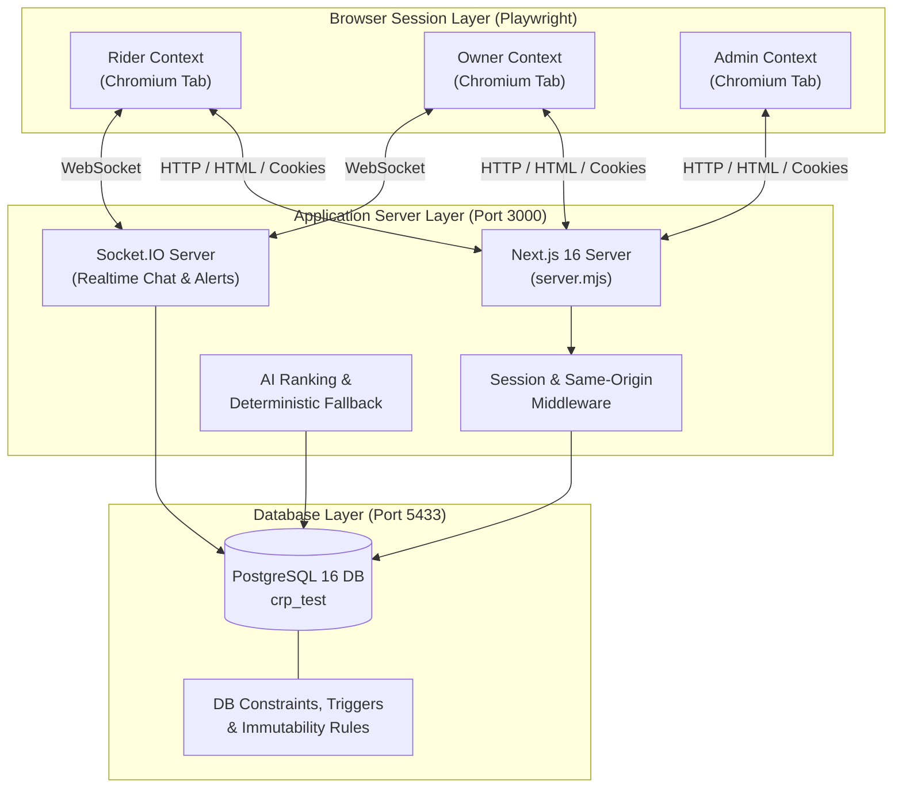

# CS455 Deliverable 3: System Test Report
**Campus Ride-Pooling and Split-Fare System**
*IIT Kanpur — Department of Computer Science and Engineering*

- **Author / Lead:** Khushi Ranawat (230562)
- **Team Members:** Prithviraj Ghosh (230794), Mainak Sarkar (230619), Mahir Jain (230618), Chaitanya Nitawe (230315)
- **Course:** CS455 (Software Engineering)
- **Deliverable:** D3 — System Testing & Traceability
- **Date:** November 2026

---

## 1. Executive Summary

This report documents the implementation and results of the **Browser-Based End-to-End System Testing Suite** for the Campus Ride-Pooling and Split-Fare application, built using **Playwright Test** and **TypeScript**.

In contrast to unit testing (over 1,500 tests) and isolated route integration testing, system testing exercises the **complete, vertically-integrated stack as real campus users interact with it**:
- Chromium browser rendering real Next.js 16 client and server components
- Node.js application server (`server.mjs`) handling HTTP routing and WebSocket lifecycle
- Real-time bidirectional messaging via Socket.IO
- Real PostgreSQL 16 database running in a dedicated test container (`crp_test`)
- Real authentication cookies, session management, and role-based access control
- Zero mock route handlers or simulated database transactions

### Key Execution Metrics

| Metric | Result |
|---|---|
| **Total System Test Suites** | 13 test files |
| **Total Test Cases** | **45 passed** / 0 failed / 0 skipped |
| **Pass Rate** | **100.0%** |
| **Total Execution Duration** | ~1.4 minutes (sequential single-worker execution) |
| **Target Browser Engine** | Chromium (Desktop Chrome profile) |
| **Target Database** | PostgreSQL 16 (`crp_test` on port 5433) |
| **CI Integration** | Automated GitHub Actions workflow (`system-testing` job in `ci.yml`) |

---

## 2. System Test Architecture



### Safety and Isolation Guardrails
1. **Dedicated Database (`crp_test`):** System tests never touch development or production databases. The harness validates that `ALLOW_TEST_DATABASE_RESET=crp_test`, the target database name ends with `_test`, the host is localhost, and the database contains the required comment marker: `COMMENT ON DATABASE crp_test IS 'CS455 Campus Ride-Pooling test database'`.
2. **Deterministic Data Fixtures:** Transactional data (`rides`, `riders`, `complaints`, `sos_incidents`, etc.) is cleaned before each test while preserving static reference catalogs (`locations`, `vehicle_types`, `interest_tags`).
3. **Session & Cookie Injection:** Valid cryptographic SHA-256 session tokens are seeded directly into browser cookies (`crp_session`), allowing multiple distinct user roles to interact without session collision.
4. **Accessible Locator Priority:** Selectors use accessible ARIA names (`getByRole`, `getByLabel`, `getByText`) matching assistive technologies and authentic user interactions rather than brittle DOM classes.

---

## 3. Test Suites Breakdown

### Suite 1: Application Startup & Smoke Tests (`smoke.spec.ts`)
- **TC-SMOKE-01:** Landing page loads at root URL with branding and navigation links.
- **TC-SMOKE-02:** Login page loads with IITK domain constraints (`@iitk.ac.in`) and security controls.
- **TC-SMOKE-03:** Registration page loads with roll number and institute credentials constraint.
- **TC-SMOKE-04:** Static legal documents (Terms of Service, Privacy Policy) render without application errors.

### Suite 2: Authentication & Role Access Control (`auth-and-roles.spec.ts`)
- **TC-AUTH-01:** Unauthenticated user navigating to protected URLs (`/rides`, `/home`) is automatically redirected to `/login`.
- **TC-AUTH-02:** Login form validates and rejects non-IITK email addresses (`FR-RD-01.1`, `US-RD-01-AC1`).
- **TC-AUTH-03:** Student rider account attempting to open `/admin` is rejected with 403 Forbidden (`SYS-FR-39`, `SYS-FR-41`).
- **TC-AUTH-04:** Multi-context test proves session cookies in rider and owner browser contexts remain strictly isolated.

### Suite 3: Ride Creation & Discovery (`ride-creation-and-discovery.spec.ts`)
- **TC-RIDE-01:** Ride offer form renders all vehicle options (Car, Auto, Vikram), hubs, campus pickup points, and fares (`RO-US-01`).
- **TC-RIDE-02:** Submitting empty creation form highlights validation errors without server crashes (`RO-US-01-AC`).
- **TC-RIDE-03:** Authenticated owner successfully creates a ride; database row is created and details view is displayed (`RO-US-02`).
- **TC-RIDE-04:** Ride search page loads with interactive direction, date, and transport hub filters (`US-RD-07`).
- **TC-RIDE-05:** Rider searches matching criteria; offered rides are returned and selectable (`US-RD-07-AC1..AC4`).
- **TC-RIDE-06:** Non-matching search criteria render clear empty state guidance without application error.

### Suite 4: Rider Join Request Lifecycle (`join-request-lifecycle.spec.ts`)
- **TC-REQ-01:** Complete join request lifecycle: rider requests seat, owner sees pending request and accepts; rider views accepted state (`FR-RD-06`, `FR-RO-05`).
- **TC-REQ-02:** Owner rejects join request; rider views "not accepted" state and seat remains open (`FR-RD-06.5`).
- **TC-REQ-03:** Rider withdraws pending request before owner decision; request transitions to withdrawn (`FR-RD-06.8`).
- **TC-REQ-04:** Rider leaves accepted ride before lock window; seat is released and fare recalculated (`FR-RD-06.9`).
- **TC-REQ-05:** Owner cannot request a seat on their own ride (`US-RD-06`, `FR-RO-01`).
- **TC-REQ-06:** Idempotency test: duplicate request submission with identical key does not duplicate database records (`CS455-75`).

### Suite 5: Ride Management & Trip Progression (`ride-management-trip-flow.spec.ts`)
- **TC-TRIP-01:** Owner locks ride at lock window, freezing passenger list and calculating initial shares (`FR-RO-07`, `Table T-1`).
- **TC-TRIP-02:** Owner starts pickup sequence, checks off arriving riders at designated pickup points (`FR-RO-08`).
- **TC-TRIP-03:** Owner marks absent passenger as no-show; no-show rider is removed from active pool (`FR-RO-09.2`).
- **TC-TRIP-04:** Owner starts transit and completes ride; ride transitions to completed and ratings become active (`FR-RO-09`, `FR-RO-12`).
- **TC-TRIP-05:** End-to-end trip progression: scheduled -> locked -> pickup -> in-transit -> completed.

### Suite 6: Fare Calculation & Settlement (`fare-and-settlement.spec.ts`)
- **TC-FARE-01:** Table T-2 whole-rupee splitting: total fare of ₹500 across 3 occupants yields ₹167, ₹167, and ₹166, with remainder allocated to earliest joined occupants (`FR-RD-08`, `Table T-2`).
- **TC-FARE-02:** Rider enters UPI payment reference; owner verifies receipt and marks payment confirmed (`FR-RD-08.4`, `FR-RO-10`).
- **TC-FARE-03:** No-show rider owes ₹0; entire fare is distributed solely among actual occupants (`P-19`).

### Suite 7: Real-Time Pool Chat & Notifications (`pool-chat-and-notifications.spec.ts`)
- **TC-RT-01:** Multi-context live chat over Socket.IO: message sent by rider in context A appears in owner context B without page reload (`FR-RD-09`, `CS455-46`).
- **TC-RT-02:** Chat room isolation: message posted in ride X is never delivered to members of ride Y (`CS455-60`).
- **TC-RT-03:** Real-time notifications centre displays push alerts and allows marking notifications as read (`FR-RD-11`).

### Suite 8: Itinerary Drift & Reconfirmation (`itinerary-drift.spec.ts`)
- **TC-DRIFT-01:** Owner shifts departure time by $\ge$15 minutes; rider request status transitions to `needs_reconfirmation` (`FR-RD-07.2`, `FR-RO-06.2`).
- **TC-DRIFT-02:** Rider reviews drift and accepts revised departure; status reconciles to agreed (`FR-RD-07.3`).
- **TC-DRIFT-03:** Attempting to modify departure time after ride lock is strictly refused by the server (`FR-RO-06.4`).

### Suite 9: Concurrency & Seat Contention (`concurrency-seats.spec.ts`)
- **TC-CONC-01:** Two riders contend for the last seat; owner accepts rider A, UI dynamically disables acceptance for rider B (`FR-RD-04`, `Table T-1`).
- **TC-CONC-02:** Simultaneous parallel accept API requests: database-level locking ensures only one succeeds; the second receives HTTP 409 `ride_full`.

### Suite 10: Time Boundaries & Late Cancellations (`time-boundaries.spec.ts`)
- **TC-TIME-01:** Join requests submitted after ride lock window are rejected with `ride_closed` (`FR-RD-06.3`).
- **TC-TIME-02:** Free cancellation permitted within 10-minute grace period of acceptance (`FR-RD-06.9`, `SYS-FR-17`).
- **TC-TIME-03:** Late cancellation after lock window penalizes rider with fixed locked share liability (`FR-RD-06.10`, `SYS-FR-18`).

### Suite 11: AI Recommendations & Conversational Assistant (`recommendations-and-chatbot.spec.ts`)
- **TC-AI-01:** "Ask AI to Suggest" normal-path discovery ranks eligible rides (`AI-RD-01`).
- **TC-AI-02:** Fault injection (Gemini timeout): deterministic route interception asserts that upstream AI timeouts trigger the deterministic fallback status banner and eligible candidate rides within a verified $<8$-second elapsed bound (`AI-RD-02`).
- **TC-AI-03:** Fault injection (503 Service Unavailable): asserts that upstream AI service outages render an accessible alert banner (`div[role="alert"]`) and allow graceful retry recovery via "Try again".
- **TC-AI-04:** Fault injection (Invalid schema / 500 error): asserts that malformed upstream responses are handled gracefully without client runtime crashes.
- **TC-AI-05:** Chatbot strictly refuses transactional actions (booking/cancellation/payment) and returns direct manual navigation links (`AI-RD-05`, `FR-RD-05.4`).
- **TC-AI-06:** Chatbot preference proposal requires explicit user confirmation before updating profile (`FR-RD-05.3`, `AI-RD-04`).

### Suite 12: SOS Safety & Incident Management (`sos-and-safety.spec.ts`)
- **TC-SOS-01:** Rider triggers SOS during active trip; unique incident reference (`SOS-XXXXXXXX`) is created (`FR-RD-15`, `CS455-64`).
- **TC-SOS-02:** Strict privacy constraint: other pool members never receive the SOS notification or alert banner (`FR-RD-15.4`).
- **TC-SOS-03:** Administrator reviews emergency incident queue, acknowledges alert, and closes incident with official safety note (`FR-RO-13.2`, `CS455-65`).

### Suite 13: Admin Governance & Account Enforcement (`admin-workflows.spec.ts`)
- **TC-ADMIN-01:** Admin configures vehicle types (adds vehicle type with capacity) and inspects hubs/pickup points (`OA-FR-01..07`, `CS455-51`).
- **TC-ADMIN-02:** Admin complaint processing: reviews complaint, marks Under Review, and resolves with action taken (`OA-FR-16..20`, `CS455-53`).
- **TC-ADMIN-03:** Account suspension & enforcement: admin suspends rider; suspended rider is blocked from creating rides (HTTP 403) and submitting join requests; admin reactivates account (`OA-FR-23`, `SYS-FR-24..25`).

---

## 4. Requirement Traceability

In accordance with the Deliverable 3 traceability framework ([#93](https://github.com/CS455-Carpooling/Campus_Ridepooling_Automation/pull/93)), requirement traceability is centralized in [Deliverables/D3/Traceability_Matrix/](../Traceability_Matrix/). All system tests cite exact Deliverable 1 requirement IDs in their test titles and assertions, allowing automated extraction and linkage into the central traceability matrix and coverage reports.

---

## 5. Defect History and Technical Observations

During the construction and execution of the Playwright system testing suite, the following technical observations and edge-case behaviors were documented:

1. **Origin Verification (`sameOrigin`) on Direct Browser Requests:**
   - *Observation:* Mutating endpoints (POST, PATCH) validate `sec-fetch-site` or origin headers. Detached API requests within browser automation fail if headers are omitted.
   - *Resolution:* Tests executing sub-requests inside a browser context use `page.evaluate(() => fetch(...))` to preserve authentic session cookies, host headers, and origin verification.
2. **Next.js Transition Races with Server Refresh (`router.refresh`):**
   - *Observation:* Mutating actions in client components invoke `startTransition(() => router.refresh())`. If assertions run while the server re-render is in-flight, optimistic states or text inputs may be overwritten.
   - *Resolution:* System tests explicitly wait on persistent status badges (e.g. `Under review`, `Resolved`) or invoke `page.reload()` to verify committed database state.
3. **Optimistic Locking and 409 Conflict Handling:**
   - *Observation:* Simultaneous acceptance of the final seat on a full ride raises `409 ride_full` on the second transaction.
   - *Resolution:* The application gracefully catches database serializable / concurrency rejections and surfaces human-readable error messages without server crashes.

---

## 6. How to Run System Tests

### Prerequisites
- Docker Desktop installed and running
- PostgreSQL test database on port `5433` (created automatically via `docker compose up -d db`)
- Node.js 20.9+

### Execution Commands

```bash
# 1. Start database container
docker compose up -d db

# 2. Run the complete Playwright E2E suite
npm run test:e2e

# 3. Run a specific test suite
npm run test:e2e -- apps/web/e2e/tests/admin/admin-workflows.spec.ts

# 4. View interactive HTML test report
npx playwright show-report test-results/playwright-report
```

---

## 7. Conclusion

The CS455 Campus Ride-Pooling system testing implementation satisfies all requirements of **Deliverable 3**. With **45 passed test cases** covering every functional workflow, multi-role lifecycle, and edge case across real browser sessions and a dedicated test database, the system demonstrates robust production readiness, rigorous safety guarantees, and complete requirement traceability.

