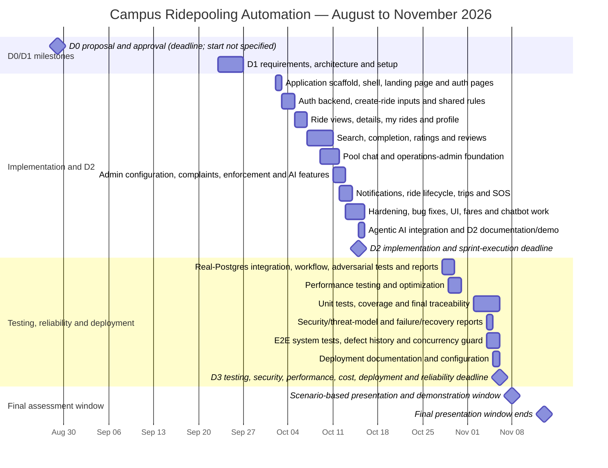

# Campus Ridepooling Automation — Project Timeline and Gantt Chart

D0 is shown as a deadline milestone because its exact start date is not
available. D1 is shown as a dated work bar covering its 23–26 September
execution window; the late addition of its files does not change that schedule.

## Gantt chart

### Column-header meaning

The date headers across the top are **week-start labels**. Each header marks
the first day of a seven-day calendar column, and the six days that follow
continue to the right. For example, **05 Sep** means the week beginning
5 September 2026, not a single-day deadline. Teal bars show dated work
windows, blue bars show phase groups, and orange diamonds mark milestones.

## Detailed work breakdown

| Dates | Workstream | Scope covered | Evidence |
|---|---|---|---|
| 29 Aug 2026 | D0 | One-page project proposal and approval gate | Milestone |
| 23–26 Sep 2026 | D1 | Requirements specification; use cases and user stories; functional and non-functional requirements; initial traceability; architecture; component/sequence diagrams; design patterns; alternatives; Jira backlog and Jira–GitHub integration; initial sprint plan; AI engineering log | Opened–merged range |
| 02 Oct 2026 | Product foundation | Next.js/TypeScript scaffold, homepage/navigation shell, landing-page refresh and authentication pages | Opened–merged range |
| 03–04 Oct 2026 | Authentication and ride creation | Authentication integration and fixes; create-ride inputs, shared ride rules, Docker/design-system restoration, create-ride flow and invalid-time fix | Opened–merged range |
| 05–06 Oct 2026 | Rider ride management | Ride-view access rules, ride details, “my rides”, profile, ride history and routing fixes | Opened–merged range |
| 07–10 Oct 2026 | Discovery and feedback | Ride search, completion/rating rules, ratings API, review page and ratings display | Opened–merged range |
| 09–11 Oct 2026 | Communication and administration | Pool chat plus operations-admin data foundation, access checks, audit/atomic actions and admin dashboard shell | Opened–merged range |
| 11–12 Oct 2026 | Admin, complaints and intelligent assistance | Search fixes; configuration, complaint and enforcement APIs/pages; complaint queue and rider records; AI recommendations; hobby tags | Opened–merged range |
| 12–13 Oct 2026 | Operational safety and live lifecycle | Notification centre/UI and delivery sync; ride requests; trip state, arrival/no-show, live controls, SOS and admin alerts | Opened–merged range |
| 13–15 Oct 2026 | Hardening and final feature completion | Ride-state/SOS fixes, notification hardening, loophole fixes, conflict resolution, UI/fare improvements and chatbot work | Opened–merged range |
| 15 Oct 2026 | D2 completion | LLM integration, D2 deliverables, API documentation, demonstration material, README and AI logs | Milestone and implementation history |
| 28–29 Oct 2026 | Integration and adversarial assurance | Real-Postgres CI harness, database fixes, core ride workflow tests, trip/SOS/complaint/rating/admin tests, idempotency fix, adversarial suite and reports | Opened–merged range |
| 29–30 Oct 2026 | Performance assurance | Performance testing and optimization work | Opened–merged range |
| 02–05 Nov 2026 | Test evidence and traceability | Unit tests, coverage report and final requirements traceability | Opened–merged range |
| 04 Nov 2026 | Security and failure assurance | Security/threat-model report and failure/recovery report | Opened–merged range |
| 04–05 Nov 2026 | System reliability | End-to-end system tests, defect-history report, concurrency experiment and seat-capacity guard | Opened–merged range |
| 05 Nov 2026 | Deployment | Deployment configuration and documentation | Opened–merged range |
| 06 Nov 2026 | D3 completion | Testing, security/threat model, performance, cost, reliability, defect history, timeline, deployment, final traceability, dashboard/report and AI log | Milestone |
| 08–13 Nov 2026 | Final demonstration | Normal workflow, concurrent-access scenario, failure scenario, security scenario and agentic-AI workflow | Assessment window |

## Completion and timing notes

- D2 feature implementation reaches its 15 Oct deadline, followed by a visible
  gap in recorded activity from 16–27 Oct. This chart does not claim that no
  work occurred during that interval.
- D3 assurance work begins on 28 Oct and reaches deployment documentation on
  05 Nov, one calendar day before the deadline.
- The later D1 file addition is deliberately excluded from the D1 completion
  date so the chart reflects the planned work window rather than the upload date.
- The machine-readable source data for this chart is available in
  [`project-timeline-gantt.csv`](./project-timeline-gantt.csv).
