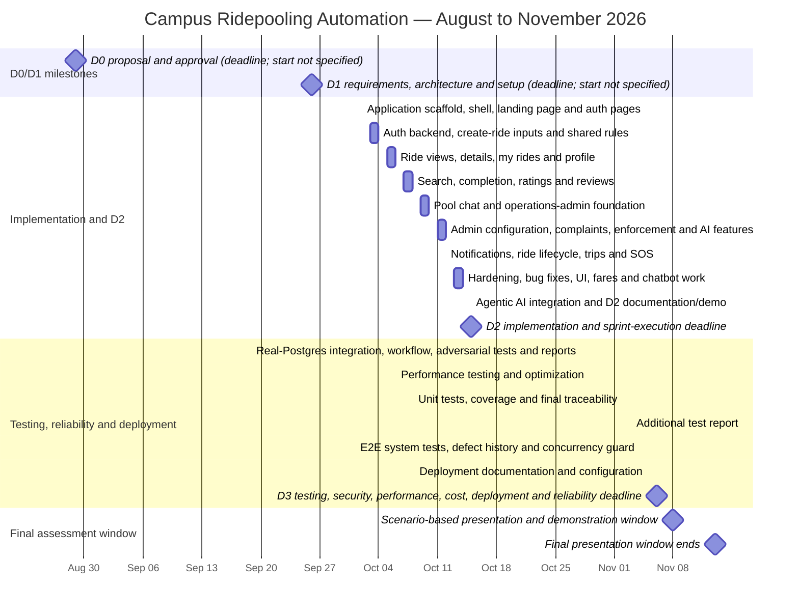

# Campus Ridepooling Automation — Project Timeline and Gantt Chart

D0 and D1 are shown as deadline milestones because their exact start dates are
not available. The late addition of their files does not change the planned
milestone dates.

## Gantt chart

## Detailed work breakdown

| Dates | Workstream | Scope covered | Evidence |
|---|---|---|---|
| 29 Aug 2026 | D0 | One-page project proposal and approval gate | Milestone |
| 26 Sep 2026 | D1 | Requirements specification; use cases and user stories; functional and non-functional requirements; initial traceability; architecture; component/sequence diagrams; design patterns; alternatives; Jira backlog and Jira–GitHub integration; initial sprint plan; AI engineering log | Milestone |
| 02 Oct 2026 | Product foundation | Next.js/TypeScript scaffold, homepage/navigation shell, landing-page refresh and authentication pages | Implementation history |
| 03–04 Oct 2026 | Authentication and ride creation | Authentication integration and fixes; create-ride inputs, shared ride rules, Docker/design-system restoration, create-ride flow and invalid-time fix | Implementation history |
| 05–06 Oct 2026 | Rider ride management | Ride-view access rules, ride details, “my rides”, profile, ride history and routing fixes | Implementation history |
| 07–08 Oct 2026 | Discovery and feedback | Ride search, completion/rating rules, ratings API, review page and ratings display | Implementation history |
| 09–10 Oct 2026 | Communication and administration | Pool chat plus operations-admin data foundation, access checks, audit/atomic actions and admin dashboard shell | Implementation history |
| 11–12 Oct 2026 | Admin, complaints and intelligent assistance | Search fixes; configuration, complaint and enforcement APIs/pages; complaint queue and rider records; AI recommendations; hobby tags | Implementation history |
| 12 Oct 2026 | Operational safety and live lifecycle | Notification centre/UI and delivery sync; ride requests; trip state, arrival/no-show, live controls, SOS and admin alerts | Implementation history |
| 13–14 Oct 2026 | Hardening and final feature completion | Ride-state/SOS fixes, notification hardening, loophole fixes, conflict resolution, UI/fare improvements and chatbot work | Implementation history |
| 15 Oct 2026 | D2 completion | LLM integration, D2 deliverables, API documentation, demonstration material, README and AI logs | Milestone and implementation history |
| 28 Oct 2026 | Integration and adversarial assurance | Real-Postgres CI harness, database fixes, core ride workflow tests, trip/SOS/complaint/rating/admin tests, idempotency fix, adversarial suite and reports | Test history |
| 29 Oct 2026 | Performance assurance | Performance testing and optimization work | Test history |
| 02–03 Nov 2026 | Test evidence and traceability | Unit tests, coverage report, final requirements traceability and additional test report | Test history |
| 04 Nov 2026 | System reliability | End-to-end system tests, defect-history report, concurrency experiment and seat-capacity guard | Test history |
| 05 Nov 2026 | Deployment | Deployment configuration and documentation | Deployment history |
| 06 Nov 2026 | D3 completion | Testing, security/threat model, performance, cost, reliability, defect history, timeline, deployment, final traceability, dashboard/report and AI log | Milestone |
| 08–13 Nov 2026 | Final demonstration | Normal workflow, concurrent-access scenario, failure scenario, security scenario and agentic-AI workflow | Assessment window |

## Completion and timing notes

- D2 feature implementation reaches its 15 Oct deadline, followed by a visible
  gap in recorded activity from 16–27 Oct. This chart does not claim that no
  work occurred during that interval.
- D3 assurance work begins on 28 Oct and reaches deployment documentation on
  05 Nov, one calendar day before the deadline.
- The later D1 file addition is deliberately excluded from the D1 completion
  date so the chart reflects the planned milestone rather than the upload date.
- The source data for this chart is available in
  [`project-timeline-gantt.csv`](./project-timeline-gantt.csv).
